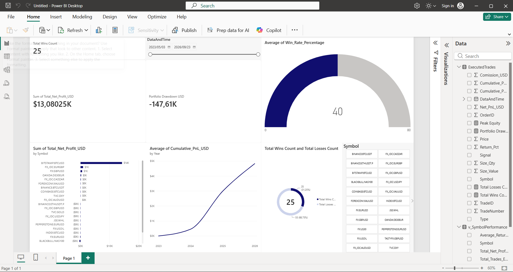
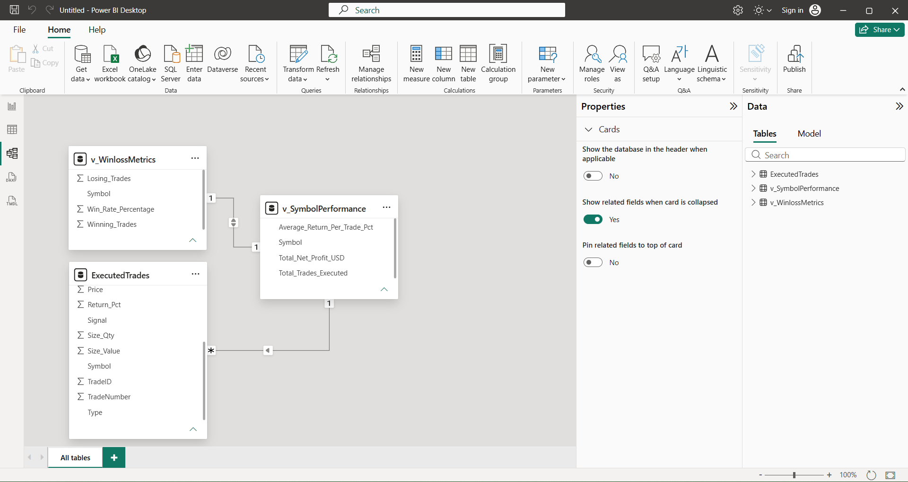

# 📈 High-Volume Trading Intelligence Data Engineering Pipeline

An end-to-end data engineering framework built to clean, structure, and model historical time-series datasets. This project utilizes Python ETL processes, native SQL Server relational schemas, and Power BI semantic modeling to isolate performance metrics from multi-row transaction logs.

> 💡 **MarTech Transferability:** This architecture directly simulates the technical challenges of managing high-frequency marketing attribution, tracking real-time web analytics clickstreams, and engineering data pipelines for enterprise behavioral event logs.

***

### 🛠️ Technology Stack & Architecture
* **ETL Engine & Data Cleaning:** Python, Pandas (Data cleaning, whitespace normalization, type casting)
* **Relational Storage & Modeling:** Microsoft SQL Server, T-SQL (Analytical views, relational constraints, schema indexing)
* **Semantic Modeling & BI Analytics:** Power BI Desktop, DAX Studio
* **Workflow Acceleration:** AI-Assisted Script Orchestration & Advanced Prompt Engineering

---

## 📌 Project Overview & Technical Scope
* **Scope:** The included records are a simulated, historically backtested dataset. Dashboard values describe this dataset only; they are not live results, independently verified performance, or investment advice.

This pipeline replaces manual, disjointed financial logging with an automated, structured data flow. It converts unstructured time-series flat files into structured relational databases, serving as a robust data model capable of supporting fast cross-filtering and executive-level analytics views.

---

## 🏗️ Pipeline Architecture & Data Flow

---

## 📁 Repository Structure & Artifacts

### 🐍 1. Python ETL & Ingestion Layer
* `clean_trading_history.py` — Analytical backend handling text-parsing optimization, regex-driven whitespace scrubbing, and absolute type conversions to ensure database ingestion conformity.

### 🗄️ 2. Database Administration & Relational Modeling (T-SQL)
* `01_db_and_table_schema-SQLQuery1.sql` — Relational schema definition specifying data integrity parameters, primary keys, and data-type rules.
* `02_data_ingestion-SQLQuery2.sql` — Production-ready data staging scripts handling bulk file ingestion records.
* `03_analytical_views-SQLQuery3.sql` — Optimized database server views tracking calculated metrics like exit-leg trajectories and half-row win-rate calculations.

### 📊 3. Business Intelligence & Semantic Reporting
* `TradingIntelligence_DataPipeLine_Dashboard.pbix` — Star-schema semantic model mapping relational views to continuous date tables.
* `TradingIntelligence_DataPipeLine_Dashboard.pdf` — Presentation-ready dashboard report showing an enterprise execution interface tracking simulated margins, drawdown curves, and win-rate ratios.

---

## 🚀 Key Professional Skills Demonstrated

1. **Complex System Architecture:** Designing automated multi-tiered data transformations (Python ➡️ SQL Server ➡️ Power BI) that handle raw log inconsistencies gracefully.
2. **Advanced Logic Mapping:** Writing conditional logic and analytics expressions (T-SQL/DAX) to evaluate operational behavior (such as tracking exit-entry pairings across disjointed transactional data tables).
3. **AI-Driven Velocity:** Utilizing generative AI tools to rapidly generate template logic, debug script errors, and optimize code formatting, focusing human oversight entirely on pipeline integrity and data quality validation.

---
*Developed by Jesus Kazaji | BCom Marketing Management & Analytics*
