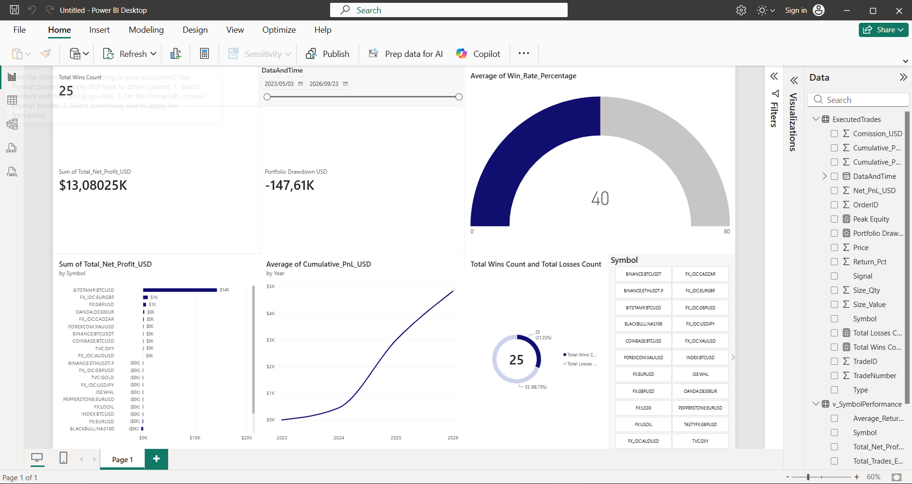
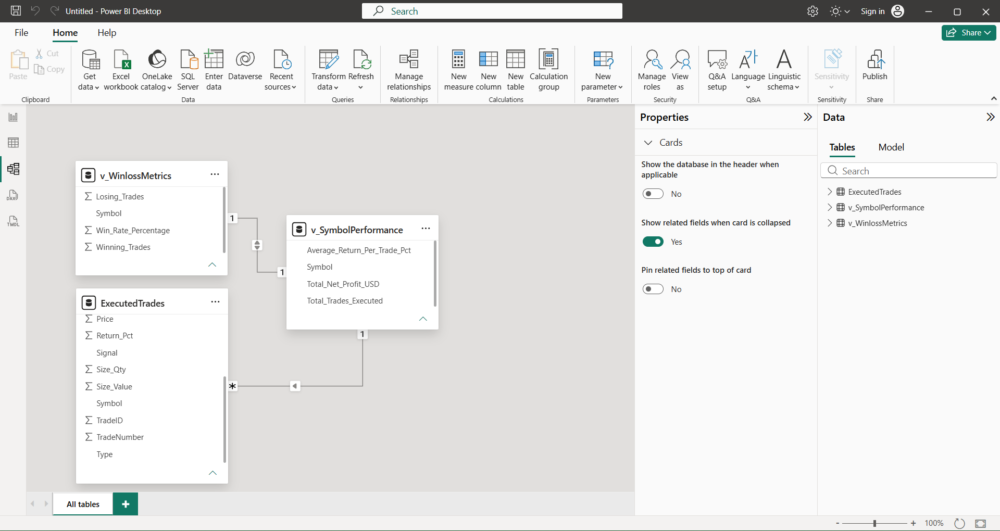

# Trading History Analytics Pipeline & Power BI Dashboard

A portfolio project demonstrating a small end-to-end workflow for cleaning historical paper-trading exports, storing trade records in SQL Server, and presenting summary measures in Power BI.

> **Scope:** The included records are a simulated, historically backtested dataset. Dashboard values describe this dataset only; they are not live results, independently verified performance, or investment advice.

## What the project demonstrates

- Python data cleaning with Pandas, including whitespace cleanup and numeric type conversion.
- SQL Server tables and views for organizing trade records and summarizing exit legs.
- A Power BI model and dashboard for exploring the sample records.

## Project files

- `clean_trading_history.py` — cleans the source export.
- `01_db_and_table_schema-SQLQuery1.sql` — creates the database schema.
- `02_data_ingestion-SQLQuery2.sql` — loads records.
- `03_analytical_views-SQLQuery3.sql` — creates summary views.
- `TradingIntelligence_DataPipeLine_Dashboard.pbix` — Power BI file.
- `TradingIntelligence_DataPipeLine_Dashboard.pdf` — dashboard export.
- `dashboard_preview.png` and `data_model_schema.png` — visual references.

## Dashboard

The current dashboard reports approximately **$13.08M gross profit** and **-$147.61K maximum drawdown** for the included simulated dataset. These values are descriptive outputs from the sample data, not evidence of a viable strategy. Review the measures and assumptions in the project files before interpreting them.

## Data model schema

The diagram below shows the SQL Server data model used to organize the trade records and support the Power BI report.

## Data pipeline

1. **Clean:** Python standardizes the exported fields and writes a cleaned data file.
2. **Store:** SQL Server holds the trade records and provides views for summary reporting.
3. **Explore:** Power BI presents the resulting measures and filters.

The win-rate view counts winning and losing exit records and divides by half of the total row count, which assumes each trade has one entry row and one exit row. If that assumption changes, the denominator should be updated to count exit rows directly.

## Limitations

The source is a paper-trading/backtest export and may be overfit or otherwise unrepresentative. Fees, slippage, margin, and other live-market effects may not be fully represented. The project is an analytics and data-modeling demonstration, not trading advice or a claim about future returns.

Developed by Jesus Kazaji | BCom Marketing Management
